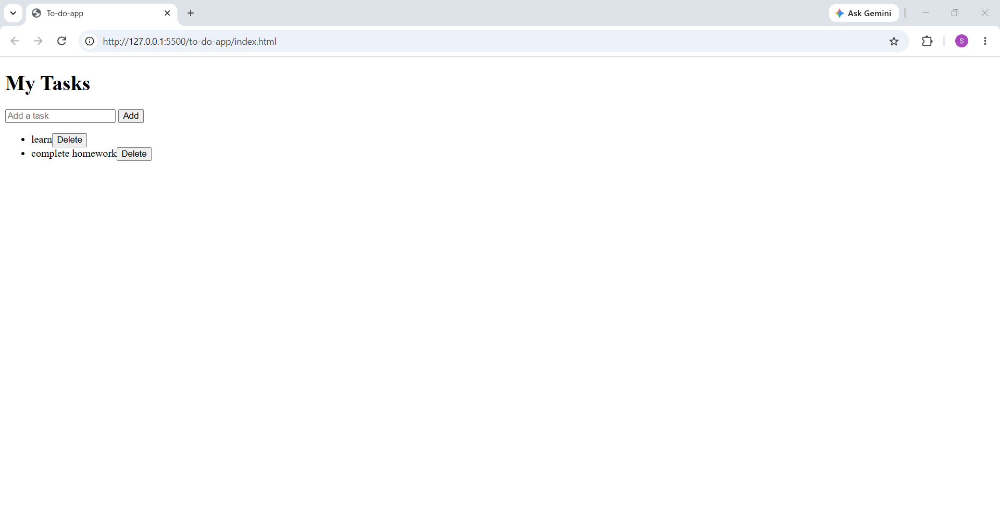
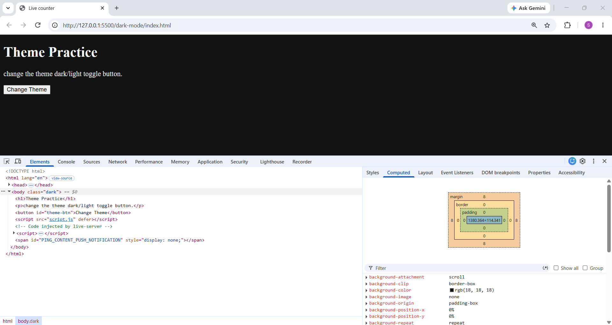

# JavaScript Mini Projects and Applications

## About This Repository

This repository contains the mini projects and applications I developed during my HackGenix web development training.

These projects helped me apply HTML, CSS and JavaScript concepts to build interactive webpages and understand real-world DOM manipulation, event handling, form validation and browser storage.

## Projects Included

### 1. Dynamic Gallery Cards

A dynamic gallery that creates cards automatically using JavaScript instead of writing each card manually in HTML.

## Screenshot

.png)

**Features:**

- Stores place details in a JavaScript array.
- Creates cards dynamically using `createElement()`.
- Displays place names and descriptions.
- Adds cards to the webpage using `append()`.

### 2. Live Counter

An interactive counter that allows users to increase and decrease a number.

## Screenshot

.png)

**Features:**

- Increment button to increase the count.
- Decrement button to decrease the count.
- Updates the displayed number immediately.
- Changes the number's colour when the count becomes negative.

### 3. Registration Form with Validation

A registration form that validates user information before allowing successful registration.

## Screenshot

.png)

**Features:**

- Accepts name, email, phone number and password.
- Checks that the name contains at least three characters.
- Validates email format.
- Checks for a valid 10-digit mobile number.
- Requires a password with at least eight characters.
- Displays error messages for invalid inputs.
- Displays a success message when all fields are valid.

### 4. To-Do List Application

A task management application that allows users to manage their daily tasks and save them in browser storage.

## Screenshot

**Features:**

- Add new tasks.
- Display the task list dynamically.
- Mark tasks as completed.
- Delete tasks.
- Save tasks using localStorage.
- Restore saved tasks after refreshing the browser.

### 5. Dark Mode

A theme-switching application that allows users to change the webpage between dark mode and light mode.

## Screenshot

**Features:**

- Switch between dark and light themes.
- Updates the webpage appearance using CSS classes.
- Uses JavaScript to handle the theme button.
- Provides a simple way to change the page appearance.

## Technologies Used

- HTML5
- CSS3
- JavaScript
- DOM Manipulation
- Browser localStorage
- Visual Studio Code
- Google Chrome DevTools
- Git and GitHub

## How to Run

1. Clone or download this repository.
2. Open the project folder in Visual Studio Code.
3. Navigate to the project you want to run.
4. Open its `index.html` file using Live Server.
5. Interact with the application in your browser.

## What I Learned

- How to create HTML elements dynamically.
- How to handle click, input and submit events.
- How to validate user input.
- How to use event delegation.
- How to store and retrieve application data using localStorage.

## Author

**Snekha R**  – HackGeniX Intern, Batch 1

